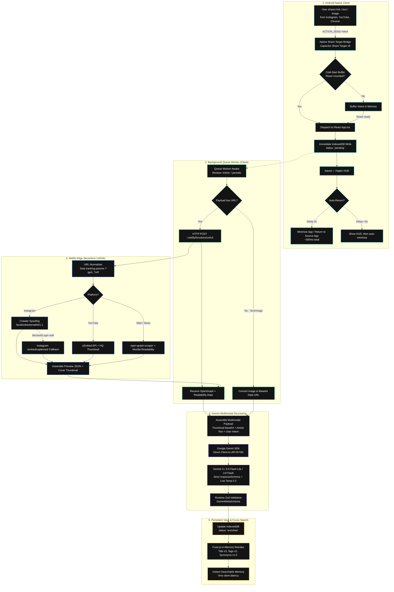
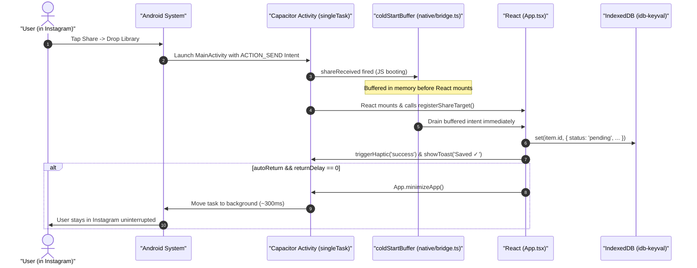
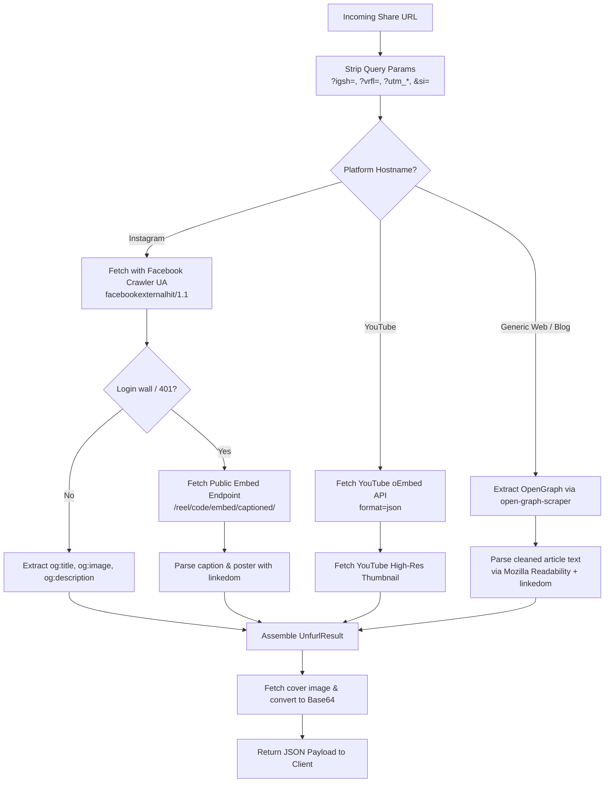
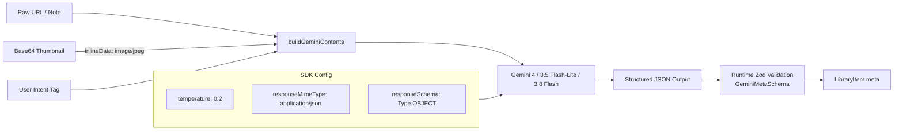
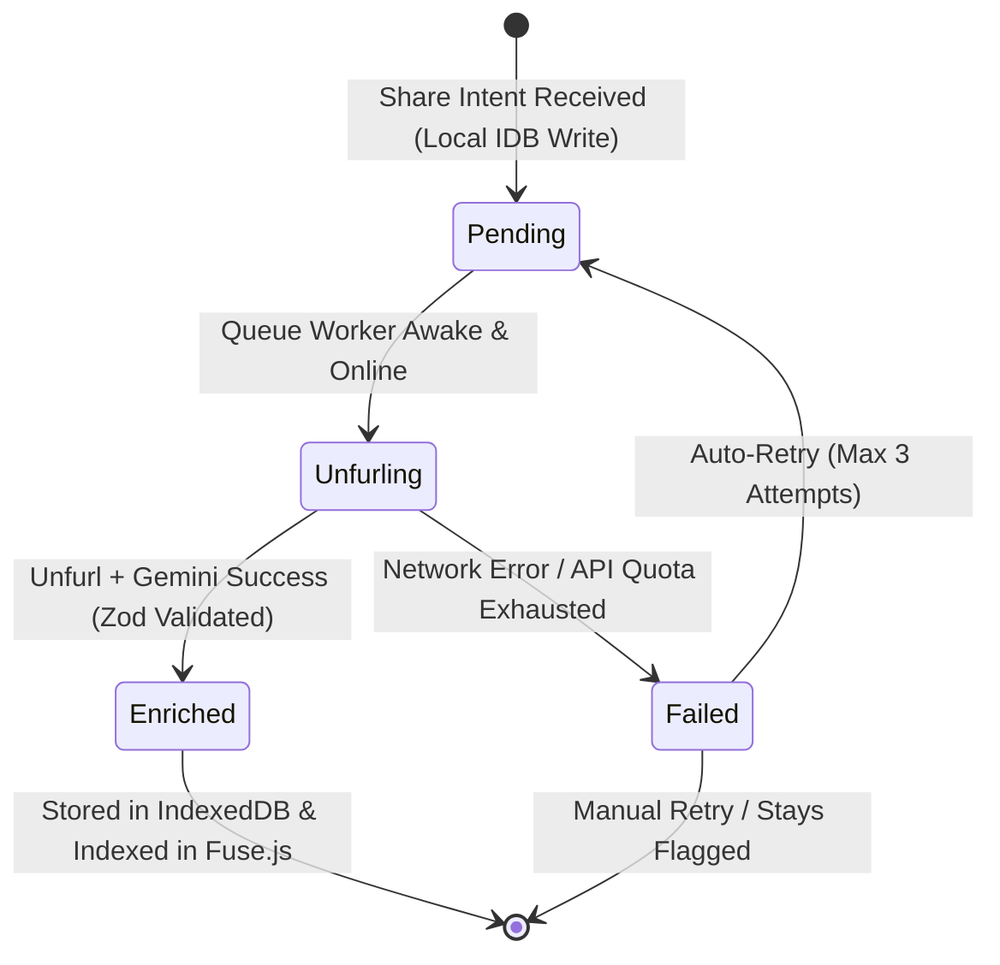

# Drop Library — System Architecture & Engineering Deep-Dive

> A technical blueprint detailing the end-to-end architecture, mobile subsystems, serverless scraper waterfall, and multimodal AI pipeline of Drop Library.

---

## 1. System Topology & End-to-End Flow

Drop Library is engineered around a unified TypeScript architecture powering a native Android application (via Capacitor 8), supported by an edge serverless metadata unfurler.

### End-to-End Data Pipeline



---

## 2. Core Architectural Pillars

### A. Sub-2-Second Capture & Cold-Start Buffering
When an app is cold-started on Android via `ACTION_SEND`, native Capacitor events can fire before the JavaScript bundle initializes and React registers its event handlers. 



To guarantee zero dropped shares:
1. `coldStartBuffer`: A module-scoped FIFO queue in `src/native/bridge.ts` registers `@capgo/capacitor-share-target` immediately upon bundle evaluation.
2. If `App.tsx` has not mounted yet, incoming intents accumulate safely in the buffer.
3. Upon mounting, `App.tsx` attaches its subscriber, which automatically drains the buffer.
4. `android:launchMode="singleTask"` in `AndroidManifest.xml` prevents Android from spawning multiple duplicate instances of `MainActivity` during rapid sharing.

---

## 3. Netlify Serverless Unfurler Waterfall

Social media platforms (especially Instagram/Meta) actively resist link scrapers by serving login walls to standard crawlers and omitting captions in share intents. 



### Unfurler Specifications:
- **Instagram Spoofing:** Employs `User-Agent: facebookexternalhit/1.1 (+http://www.facebook.com/externalhit_uatext.php)`. Platforms permit this agent to generate link preview cards on WhatsApp and Messenger.
- **Embed Fallback:** When crawler headers fail, requests are rewritten to the public iframe route: `https://www.instagram.com/p/{shortcode}/embed/captioned/`.
- **Thumbnail Fetching:** Cover images are downloaded in the serverless function and delivered as Base64 strings. This prevents CORS blocks on the client and eliminates broken images caused by Instagram's short-lived temporary CDN signed URLs.

---

## 4. Gemini Multimodal OCR & Semantic Structuring

Creators on Instagram and YouTube often leave caption text minimal, placing the key hook or title directly onto the video cover frame. Passing only textual URLs to an LLM produces generic summaries.

Drop Library solves this by using **Multimodal Vision** in `@google/genai`:



### JSON Schema & Zod Definition:
```typescript
{
  title: string;              // High-clarity, non-clickbait title
  tldr: string;               // 1-2 punchy sentences capturing core insight
  category: 'reel' | 'article' | 'essay' | 'tool' | 'quote' | 'inspo';
  tags: string[];             // 3-5 normalized lowercase tags
  searchSynonyms: string[];   // 5-8 conceptual query equivalents
  authorOrHandle?: string;    // Creator name or publication
  estimatedReadMinutes?: number;
}
```

### Why Search Synonyms Matter:
A reel demonstrating the 50/30/20 budgeting rule might be titled *"Stop doing this in 2026"*. 
Gemini generates search synonyms:
`["personal finance", "budgeting method", "saving money", "50 30 20 rule", "wealth building"]`

When a user types **"how to save money"** in Fuse.js, the item matches with high precision even though those words never appeared in the video's original title or caption.

---

## 5. Offline Queue State Machine

The client queue worker operates as an autonomous background reconciliation engine:



- **Zero Data Loss:** Items write to IndexedDB before any network request fires. If the phone loses connectivity, drops remain safe in `pending` state.
- **Auto-Reconciliation:** The worker listens to `window.addEventListener('online')` and triggers sync automatically when connection restores.
- **Concurrency Locks:** Atomic `isProcessing` locks prevent race conditions during rapid multi-item sharing.

---

## 6. Android WebView & Hardware Quirks Solved

Building high-performance hybrid applications requires overcoming subtle OS-level quirks:

| Issue / Hardware Bug | Root Cause | Engineering Solution |
| :--- | :--- | :--- |
| **Gboard Autocomplete & Paste Missing** | Setting `android.captureInput: true` in `capacitor.config.ts` forced `CapacitorWebView` to return a dummy `BaseInputConnection(this, false)`, disabling Chromium's native IME bridge. | Removed `captureInput` completely. Android Gboard autocorrect, predictions, and clipboard paste drawer resumed native operation. |
| **Blinding White Model Selector** | Native HTML `<select>` triggers Android's OS-level `AlertDialog` spinner. On custom skins (Vivo OriginOS/FuntouchOS), the system style overrides web dark mode, causing white-on-white text clipping. | Built a custom OLED card component with glowing neon borders, radio indicators, and haptic feedback. Zero native OS dialogs. |
| **Expiring Shared Media Files** | `@capgo/capacitor-share-target` writes shared images to Android's temporary cache (`/data/user/0/.../cache`), which the OS deletes after hours or days. | Read file bytes through `@capacitor/filesystem` immediately upon share and persist as persistent Base64 Data URLs in IndexedDB. |
| **Kotlin JDK Toolchain Failure** | `@capacitor/filesystem` v8 defaults to Kotlin `jvmToolchain(21)`, failing on development machines configured with JDK 17. | Added a project-level override in `android/build.gradle`: `project.kotlin { jvmToolchain(17) }`. |
| **Hardware Back Button Traps** | Android's hardware back gesture was either closing the entire application or behaving inconsistently with modals open. | Implemented hierarchical back-stack handlers via `@capacitor/app`. Pressing back closes sub-modals (e.g. Delete Confirm) &rarr; closes Detail Drawer &rarr; minimizes app. |

---

## 7. Security, Privacy & $0 Infrastructure Model

```
+-------------------------------------------------------------+
|                     Public GitHub Repo                      |
|                (Zero hardcoded API secrets)                 |
+-------------------------------------------------------------+
                              │
                              ▼
+-------------------------------------------------------------+
|                    Client Device (Phone)                    |
|  - Gemini API Key stored in sandboxed local IndexedDB       |
|  - Content stored locally on-device                         |
|  - Connects directly to generativelanguage.googleapis.com   |
+-------------------------------------------------------------+
                              │
                (Anonymous URL unfurl only)
                              ▼
+-------------------------------------------------------------+
|               Netlify Edge Serverless Unfurler              |
|  - Crawls public OpenGraph metadata & Readability HTML      |
|  - Zero credentials, zero database, zero user tracking      |
+-------------------------------------------------------------+
```

1. **Strict BYOK (Bring Your Own Key):** Each user enters their personal free-tier Google AI Studio API key in settings. The key is stored solely in client-side IndexedDB.
2. **Zero Middleman Relay:** Gemini API calls are made directly from the client to Google's endpoints. No intermediate servers log or proxy your API calls.
3. **Stateless Edge Crawling:** The Netlify serverless function is completely stateless, requiring no credentials or database.
4. **$0 Operating Cost:**
   - Netlify Functions: 125,000 free requests/month.
   - Google AI Studio: Free tier for Gemini Flash models (15 RPM).
   - Storage: Local IndexedDB (unlimited within device capacity).
