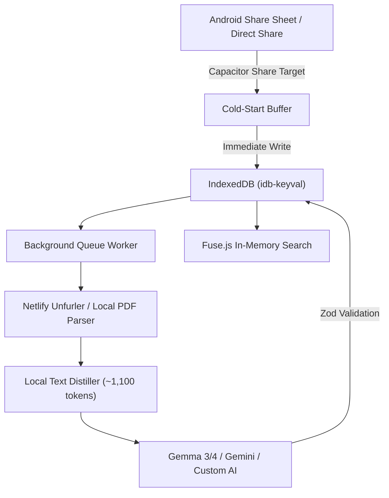

# Drop Library

<div align="center">

[](https://developer.android.com/)
[](https://github.com/Prashantispacific/drop-library/releases/latest)
[](https://capacitorjs.com/)
[](./LICENSE)
[](https://react.dev/)
[](https://aistudio.google.com/)

**A minimal, offline-first personal knowledge and media vault for Android and the Web.**  
*Capture links, Reels, YouTube videos, PDFs, notes, and screenshots via the Android Share Sheet without manual filing.*

[Download Latest APK](https://github.com/Prashantispacific/drop-library/releases/latest) · [Architecture](./ARCHITECTURE.md) · [Contributing](./CONTRIBUTING.md) · [Security Policy](./SECURITY.md)

</div>

---

## Philosophy

Most bookmarking apps suffer from folder fatigue—forcing you to categorize, tag, and file every link the moment you save it.

**Drop Library** is built for zero-friction capture:
- **Sub-2-Second Capture:** Share any link, PDF, text note, or image via Android's Direct Share / Share Sheet. The item is saved locally to IndexedDB immediately and returns you to your previous app.
- **Local PDF & Document Distillation:** Long PDFs and text files (`.pdf`, `.md`, `.txt`, `.json`, `.csv`, code) are parsed on-device via `pdfjs-dist` and distilled into a compact digest (~1,100 tokens max) before AI enrichment.
- **Gemma 3 & 4 Default + Dual-Engine AI:** Defaults to `gemma-3-27b-it` (with `gemma-4-26b-a4b-it`, `gemma-4-31b-it`, and Gemini models available) via the official `@google/genai` SDK, with automatic fallback to OpenAI-compatible providers (OpenRouter, NVIDIA NIM, Groq, Ollama).
- **Instant Client-Side Search:** Fuzzy search across titles, tags, notes, and AI-generated synonyms using `Fuse.js`.
- **Strict BYOK Privacy:** No user accounts, no tracking, and no server-side storage. API keys and vault data stay on-device in IndexedDB.

---

## Architecture



For full technical details, see [ARCHITECTURE.md](./ARCHITECTURE.md).

---

## Tech Stack

- **Mobile:** Capacitor 8 (`com.droplibrary.app`), Android Direct Share Shortcuts
- **Frontend:** React 19, TypeScript, Vite, Tailwind CSS
- **Storage & Search:** `idb-keyval` (IndexedDB), `Fuse.js`
- **Document & Image Processing:** `pdfjs-dist` (local PDF text extraction), offscreen canvas image compression
- **AI & Validation:** `@google/genai`, OpenAI-compatible fetch client, `Zod`
- **Serverless Unfurler:** Netlify Functions (`open-graph-scraper`, `@mozilla/readability`, `linkedom`)

---

## Building the Android APK

### Prerequisites
- Node.js 20+
- JDK 17
- Android SDK & Platform Tools

### Commands

```bash
git clone https://github.com/Prashantispacific/drop-library.git
cd drop-library

npm install
npm run build
npx cap sync android

cd android
./gradlew assembleDebug
cd ..

adb install -r android/app/build/outputs/apk/debug/app-debug.apk
```

---

## Bring Your Own Key (BYOK)

1. **Google AI Studio (Gemma / Gemini):**
   - Generate a free API key at [Google AI Studio](https://aistudio.google.com/app/apikey).
   - Open **Settings** in Drop Library and paste your key.
2. **Custom OpenAI-Compatible Provider:**
   - Select OpenRouter, NVIDIA NIM, Groq, Ollama, or a custom endpoint in **Settings**.
   - Keys are stored solely in local IndexedDB on your device.

---

## License & Author

- **Made by Prashant** — [github.com/Prashantispacific/drop-library](https://github.com/Prashantispacific/drop-library)
- Licensed under the [MIT License](./LICENSE)
