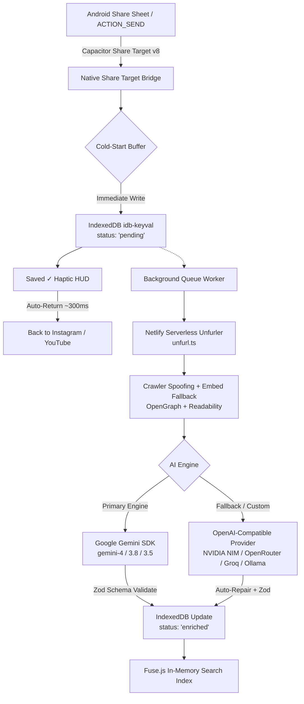

# Drop Library 📦⚡

<div align="center">

[](https://developer.android.com/)
[](https://github.com/Prashantispacific/drop-library/releases/latest)
[](https://capacitorjs.com/)
[](./LICENSE)
[](https://react.dev/)
[](https://vitejs.dev/)
[](https://tailwindcss.com/)
[](https://aistudio.google.com/)
[](https://openrouter.ai/)
[](#-0-infrastructure-economics)

**A personal, zero-friction, offline-first universal knowledge & media vault for Android.**  
*Save Instagram Reels, YouTube videos, articles, quotes, and screenshots directly via the system Share Sheet without manual filing or note-taking.*

[⬇️ **Download Latest APK (v1.0.0)**](https://github.com/Prashantispacific/drop-library/releases/download/v1.0.0/drop-library-v1.0.0.apk) • [**Architecture Deep-Dive**](./ARCHITECTURE.md) • [**Engineering Manual**](./guide.html) • [**Contributing**](./CONTRIBUTING.md) • [**Security Policy**](./SECURITY.md)

</div>

---

## 🏷️ Repository Tags & Topics

`android` • `capacitor` • `gemini-ai` • `openrouter` • `nvidia-nim` • `groq` • `ollama` • `knowledge-vault` • `read-later` • `share-target` • `offline-first` • `multimodal-ai` • `ocr` • `byok` • `personal-library` • `fuse-search`

---

## ⚡ The "Drop & Forget" Philosophy

Most "Read Later" and bookmarking apps suffer from **Folder Fatigue**: the moment you share something interesting from your phone, the app forces you to organize it into folders, choose tags, or write notes. Over time, friction increases and the vault becomes a graveyard of unindexed links.

**Drop Library is engineered for zero friction on Android:**
1. **Sub-2-Second Capture:** Share any link, text note, or image from Instagram, YouTube, or your mobile browser. The app captures the intent immediately, shows a minimal translucent HUD (`Saved ✓`), and returns you to your source app within ~300ms.
2. **Zero Video Downloads:** Never waste gigabytes downloading heavy MP4 files. The app stores canonical URLs, high-res preview metadata, and compact AI-structured JSON (~2 KB per drop).
3. **Dual Multimodal AI Engines:** Powered natively by Google GenAI SDK (`gemini-4-carbon`, `gemini-4-argon`, `gemini-4-hydrogen`, `gemini-3.8-flash`, `gemini-3.5-flash-lite`) with seamless automatic fallback to **Custom OpenAI-Compatible Providers** (OpenRouter, NVIDIA NIM, Groq, Ollama). Performs OCR on video cover hook text, writes concise summaries, classifies categories, and generates 5–8 conceptual search synonyms.
4. **Collapsible Panels & Persistent Stored Models:** Mobile-first accordion controls save screen space, while user-added custom models are persisted permanently in IndexedDB for 1-tap switching.
5. **Instant 0ms Client-Side Search:** Full fuzzy search across titles, tags, and AI conceptual synonyms via `Fuse.js` running in-memory over `IndexedDB`.
6. **100% Public-Repo Safe (BYOK):** Zero hardcoded API keys. Bring Your Own Key (Google AI Studio and/or OpenRouter/NVIDIA) stored strictly in on-device IndexedDB.

---

## 🏗️ System Architecture



> 📖 **Want the full engineering breakdown?** Read [ARCHITECTURE.md](./ARCHITECTURE.md) for sequence diagrams, Android hardware bug fixes, and scraper waterfall details.

---

## 🚀 Key Features

| Feature | Description |
| :--- | :--- |
| 📱 **Native Android Integration** | System Share Sheet support via `@capgo/capacitor-share-target` v8 with cold-start buffer and `singleTask` launch mode. |
| 🖤 **OLED Dark Aesthetic** | Pure `#0A0A0A` canvas with toggleable `#000000` True Black mode for AMOLED battery savings. |
| 📝 **Markdown Viewer & Editor** | View and edit rich `.md` notes directly in the app with GitHub Flavored Markdown (GFM) formatting. |
| 🖼️ **Multimodal Image Drops** | Share or drop images and infographics directly; Gemini automatically extracts on-screen text and details via OCR. |
| 🏷️ **1-Tap Quick Intent Chips** | Instantly categorize drops on capture (`#toread`, `#inspo`, `#tool`, `#code`, `#quote`, `#project`). |
| 🔄 **Offline-First Resilience** | Full local storage with `idb-keyval`. Enqueues drops offline and automatically reconciles when internet restores. |
| 🤖 **Dual-Engine AI Fallback** | Default Google Gemini multimodal structuring with automatic fallback to OpenAI-compatible endpoints (OpenRouter, NVIDIA NIM, Groq, Ollama). |
| 🎛️ **Collapsible Stored Models** | Accordion model controls prevent vertical scroll fatigue; store custom models permanently in IndexedDB for 1-tap switching. |
| 🩺 **Self-Diagnostic Test** | Built-in "Test Connection" button validates API credentials, endpoint latency, and schema parsing before saving. |
| 🔒 **Public-Repo Safe (BYOK)** | Bring Your Own Key model keeps all API keys strictly isolated inside local device storage. |

---

## 🛠️ Tech Stack

- **Mobile Platform:** Native Android APK via Capacitor 8 (`com.droplibrary.app`)
- **Native Plugins:** `@capacitor/app`, `@capacitor/browser`, `@capacitor/filesystem`, `@capacitor/haptics`, `@capacitor/status-bar`, `@capgo/capacitor-share-target`
- **Network Engine:** Native `CapacitorHttp` (OkHttp) on Android for CORS immunity; Netlify serverless proxy (`aiProxy.ts`) for web client
- **Frontend Core:** React 19, Vite 6, TypeScript, Tailwind CSS
- **Local Storage & Indexing:** `idb-keyval` (IndexedDB), `Fuse.js` (in-memory fuzzy search)
- **Edge Metadata Unfurler:** Netlify Serverless Functions (`open-graph-scraper`, `@mozilla/readability`, `linkedom`)
- **AI Structuring:** Official `@google/genai` SDK + OpenAI-compatible Fetch client with strict Zod schema normalization & auto-repair
- **Markdown Engine:** `marked` v18.2

---

## 🏁 Building the Android APK

### Prerequisites
- **Node.js**: v20 or higher
- **JDK**: Java Development Kit 17
- **Android SDK & Platform Tools**: Build Tools 34+

### Build & Install via ADB

```bash
# 1. Clone repository
git clone https://github.com/Prashantispacific/drop-library.git
cd drop-library

# 2. Install dependencies
npm install

# 3. Build web distribution & sync Capacitor
npm run build
npx cap sync android

# 4. Assemble Debug APK with Gradle
cd android
./gradlew assembleDebug
cd ..

# 5. Stream install onto your connected Android phone
adb install -r drop-library-v1.0.0.apk

# 6. Launch app on device
adb shell am start -n com.droplibrary.app/.MainActivity
```

---

## 🔑 Bring Your Own Key (BYOK) Setup

1. **Google Gemini (Default):**
   - Get a free API key from [Google AI Studio](https://aistudio.google.com/app/apikey).
   - In Drop Library Settings, enter your key into **Google AI Studio Key**.
   - Tap **"Test Gemini Connection"** to verify live connectivity.

2. **Custom OpenAI-Compatible Provider (Fallback / Alternative):**
   - Choose a preset (*OpenRouter*, *NVIDIA NIM*, *Groq*, or local *Ollama*) or enter your custom API Endpoint URL.
   - Enter your provider API Key and choose a model (e.g. `meta-llama/llama-3.3-70b-instruct`, `deepseek/deepseek-r1`).
   - Tap **"Test Custom Provider Connection"** to verify.
   - All keys are stored strictly in client IndexedDB and never transmitted to intermediary servers.

---

## 💰 $0 Infrastructure Economics

Drop Library costs **$0.00/month** to run indefinitely:
- **Netlify Functions:** Free tier includes 125,000 monthly invocations and 100 GB bandwidth for metadata unfurling.
- **Google AI Studio:** Free tier includes 15 requests/minute for Gemini 2.5 Flash.
- **Client Storage:** Uses your Android device's local IndexedDB with zero cloud database fees.

---

## 📄 License & Contributing

- Code licensed under the [MIT License](./LICENSE).
- Interested in contributing? Check out [CONTRIBUTING.md](./CONTRIBUTING.md).
- Questions about security? Review our [SECURITY.md](./SECURITY.md).
