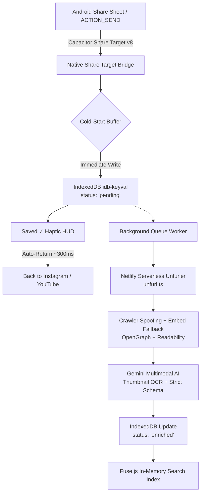

# Drop Library 📦⚡

<div align="center">

[](https://developer.android.com/)
[](https://capacitorjs.com/)
[](./LICENSE)
[](https://react.dev/)
[](https://vitejs.dev/)
[](https://tailwindcss.com/)
[](https://aistudio.google.com/)
[](#-0-infrastructure-economics)

**A personal, zero-friction, offline-first universal knowledge & media vault for Android.**  
*Save Instagram Reels, YouTube videos, articles, quotes, and screenshots directly via the system Share Sheet without manual filing or note-taking.*

[**Architecture Deep-Dive**](./ARCHITECTURE.md) • [**Contributing**](./CONTRIBUTING.md) • [**Security Policy**](./SECURITY.md)

</div>

---

## 🏷️ Repository Tags & Topics

`android` • `capacitor` • `gemini-ai` • `knowledge-vault` • `read-later` • `share-target` • `offline-first` • `multimodal-ai` • `ocr` • `byok` • `personal-library` • `fuse-search`

---

## ⚡ The "Drop & Forget" Philosophy

Most "Read Later" and bookmarking apps suffer from **Folder Fatigue**: the moment you share something interesting from your phone, the app forces you to organize it into folders, choose tags, or write notes. Over time, friction increases and the vault becomes a graveyard of unindexed links.

**Drop Library is engineered for zero friction on Android:**
1. **Sub-2-Second Capture:** Share any link, text note, or image from Instagram, YouTube, or your mobile browser. The app captures the intent immediately, shows a minimal translucent HUD (`Saved ✓`), and returns you to your source app within ~300ms.
2. **Zero Video Downloads:** Never waste gigabytes downloading heavy MP4 files. The app stores canonical URLs, high-res preview metadata, and compact AI-structured JSON (~2 KB per drop).
3. **Multimodal AI Librarian:** Powered by Google's Gemini SDK (`gemini-2.5-flash` / `gemini-3.5-flash-lite`). It performs optical character recognition (OCR) on video thumbnail hook text, writes concise summaries, classifies categories, and generates 5–8 search synonyms.
4. **Instant 0ms Client-Side Search:** Full fuzzy search across titles, tags, and AI conceptual synonyms via `Fuse.js` running in-memory over `IndexedDB`.
5. **100% Public-Repo Safe (BYOK):** Zero hardcoded API keys. Bring Your Own Key (free-tier Google AI Studio) stored securely in on-device IndexedDB.

---

## 🏗️ System Architecture



> 📖 **Want the full engineering breakdown?** Read [ARCHITECTURE.md](./ARCHITECTURE.md) for sequence diagrams, Android hardware bug fixes, and scraper waterfall details.

---

## 🚀 Key Features

| Feature | Description |
| :--- | :--- |
| 📱 **Native Android Integration** | System Share Sheet support via `@capgo/capacitor-share-target` v8 with cold-start buffer and `singleTask` launch mode. |
| 🖤 **OLED Dark Aesthetic** | Pure `#0A0A0A` canvas with toggleable `#000000` True Black mode for AMOLED battery savings. |
| 📝 **Markdown Viewer & Editor** | View and edit rich `.md` notes directly in the app with GitHub Flavored Markdown (GFM) formatting. |
| 🖼️ **Multimodal Image Drops** | Share or drop images and infographics directly; Gemini automatically extracts on-screen text and details via OCR. |
| 🏷️ **1-Tap Quick Intent Chips** | Instantly categorize drops on capture (`#toread`, `#inspo`, `#tool`, `#code`, `#quote`, `#project`). |
| 🔄 **Offline-First Resilience** | Full local storage with `idb-keyval`. Enqueues drops offline and automatically reconciles when internet restores. |
| 🔒 **Public-Repo Safe (BYOK)** | Bring Your Own Key model keeps Google AI Studio keys isolated in local device storage. |

---

## 🛠️ Tech Stack

- **Mobile Platform:** Native Android APK via Capacitor 8
- **Native Plugins:** `@capacitor/app`, `@capacitor/browser`, `@capacitor/filesystem`, `@capacitor/haptics`, `@capacitor/status-bar`, `@capgo/capacitor-share-target`
- **Frontend Core:** React 19, Vite 6, TypeScript, Tailwind CSS v4
- **Local Storage & Indexing:** `idb-keyval` (IndexedDB), `Fuse.js` (client-side fuzzy search)
- **Edge Metadata Unfurler:** Netlify Serverless Functions (`open-graph-scraper`, `@mozilla/readability`, `linkedom`)
- **AI Structuring:** Official `@google/genai` SDK with strict JSON Schema and runtime Zod validation
- **Markdown Engine:** `marked` v18.2

---

## 🏁 Building the Android APK

### Prerequisites
- **Node.js**: v20 or higher
- **JDK**: Java Development Kit 17
- **Android SDK & Platform Tools**: Build Tools 34+

### Build & Install via ADB

```bash
# 1. Clone repository
git clone https://github.com/Prashantispacific/drop-library.git
cd drop-library

# 2. Install dependencies
npm install

# 3. Build web distribution & sync Capacitor
npm run build
npx cap sync android

# 4. Assemble Debug APK with Gradle
cd android
./gradlew assembleDebug
cd ..

# 5. Stream install onto your connected Android phone
adb install -r android/app/build/outputs/apk/debug/app-debug.apk

# 6. Launch app on device
adb shell am start -n com.droplibrary.app/.MainActivity
```

---

## 🔑 Bring Your Own Key (BYOK) Setup

1. Get a free API key from [Google AI Studio](https://aistudio.google.com/app/apikey).
2. Open Drop Library on your Android phone.
3. Tap the **Settings (gear icon)** at the top right.
4. Paste your key into the **Google AI Studio Key** field and tap **Save Changes**.
5. Your key is saved strictly in your device's private IndexedDB and never transmitted to any third-party server.

---

## 💰 $0 Infrastructure Economics

Drop Library costs **$0.00/month** to run indefinitely:
- **Netlify Functions:** Free tier includes 125,000 monthly invocations and 100 GB bandwidth for metadata unfurling.
- **Google AI Studio:** Free tier includes 15 requests/minute for Gemini 2.5 Flash.
- **Client Storage:** Uses your Android device's local IndexedDB with zero cloud database fees.

---

## 📄 License & Contributing

- Code licensed under the [MIT License](./LICENSE).
- Interested in contributing? Check out [CONTRIBUTING.md](./CONTRIBUTING.md).
- Questions about security? Review our [SECURITY.md](./SECURITY.md).
