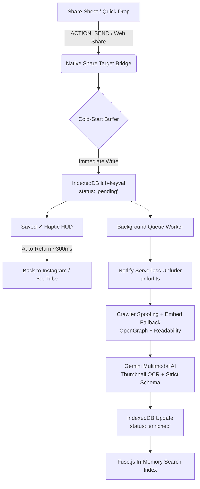

# Drop Library 📦✨

<div align="center">

[](./LICENSE)
[](https://react.dev/)
[](https://capacitorjs.com/)
[](https://vitejs.dev/)
[](https://tailwindcss.com/)
[](https://aistudio.google.com/)
[](#-0-infrastructure-economics)

**A personal, zero-friction, offline-first universal knowledge vault for mobile & web.**  
*Save Instagram Reels, YouTube videos, articles, quotes, and screenshots without manual filing or note-taking.*

[**Live Web PWA**](https://drop-vault-pg.netlify.app) • [**Architecture Deep-Dive**](./ARCHITECTURE.md) • [**Contributing**](./CONTRIBUTING.md)

</div>

---

## ⚡ The "Drop & Forget" Philosophy

Most "Read Later" and bookmarking apps suffer from **Folder Fatigue**: the moment you share something interesting, the app forces you to organize it into folders, choose tags, or write notes. Over time, friction increases and the vault becomes a graveyard of unindexed links.

**Drop Library is engineered for zero friction:**
1. **Sub-2-Second Capture:** Share any link, text note, or image from Instagram, YouTube, or your browser. The app captures it, shows a minimal translucent HUD (`Saved ✓`), and returns you immediately to your source app within ~300ms.
2. **Zero Video Downloads:** Never waste gigabytes downloading heavy MP4 files. The app stores canonical URLs, high-res preview metadata, and compact AI-structured JSON (~2 KB per drop).
3. **Multimodal AI Librarian:** Powered by Google's Gemini SDK (`gemini-2.5-flash` / `gemini-3.5-flash-lite`). It performs optical character recognition (OCR) on video thumbnail hook text, writes concise summaries, classifies categories, and generates 5–8 search synonyms.
4. **Instant 0ms Client-Side Search:** Full fuzzy search across titles, tags, and AI conceptual synonyms via `Fuse.js` running in-memory over `IndexedDB`.
5. **100% Public-Repo Safe (BYOK):** Zero hardcoded API keys. Bring Your Own Key (free-tier Google AI Studio) stored securely in local IndexedDB.

---

## 🏗️ System Architecture



> 📖 **Want the full engineering breakdown?** Read [ARCHITECTURE.md](./ARCHITECTURE.md) for sequence diagrams, Android hardware bug fixes, and scraper waterfall details.

---

## 🚀 Key Features

| Feature | Description |
| :--- | :--- |
| 📱 **Native Android Integration** | System Share Sheet support via `@capgo/capacitor-share-target` v8 with cold-start buffer and `singleTask` launch mode. |
| 🖤 **OLED Dark Aesthetic** | Pure `#0A0A0A` canvas with toggleable `#000000` True Black mode for AMOLED battery savings. |
| 📝 **Markdown Viewer & Editor** | View and edit rich `.md` notes directly in the app with GitHub Flavored Markdown (GFM) formatting. |
| 🖼️ **Multimodal Image Drops** | Share or drop images and infographics directly; Gemini automatically extracts on-screen text and details via OCR. |
| 🏷️ **1-Tap Quick Intent Chips** | Instantly categorize drops on capture (`#toread`, `#inspo`, `#tool`, `#code`, `#quote`, `#project`). |
| 🔄 **Offline-First Resilience** | Full local storage with `idb-keyval`. Enqueues drops offline and automatically reconciles when internet restores. |
| 🔒 **Public-Repo Safe (BYOK)** | Bring Your Own Key model keeps Google AI Studio keys isolated in local device storage. |

---

## 🛠️ Tech Stack

- **Frontend:** React 19, Vite 6, TypeScript, Tailwind CSS v4
- **Mobile Bridge:** Capacitor 8 (`@capacitor/core`, `@capacitor/app`, `@capacitor/browser`, `@capacitor/filesystem`, `@capacitor/haptics`, `@capacitor/status-bar`, `@capgo/capacitor-share-target`)
- **Local Storage & Indexing:** `idb-keyval` (IndexedDB), `Fuse.js` (client-side fuzzy search)
- **Edge Serverless Unfurler:** Netlify Functions (`open-graph-scraper`, `@mozilla/readability`, `linkedom`)
- **AI Structuring:** Official `@google/genai` SDK with strict JSON Schema and runtime Zod validation
- **Markdown Engine:** `marked` v18.2

---

## 🏁 Getting Started

### 1. Web PWA Setup

```bash
# Clone the repository
git clone https://github.com/Prashantispacific/drop-library.git
cd drop-library

# Install dependencies
npm install

# Start development server
npm run dev
```

Visit `http://localhost:5173` in your browser.

### 2. Android APK Build & Install

```bash
# 1. Build web distribution
npm run build

# 2. Sync native Android assets
npx cap sync android

# 3. Assemble Debug APK
cd android
./gradlew assembleDebug
cd ..

# 4. Install onto connected Android device
adb install -r android/app/build/outputs/apk/debug/app-debug.apk
```

---

## 🔑 Bring Your Own Key (BYOK) Setup

1. Get a free API key from [Google AI Studio](https://aistudio.google.com/app/apikey).
2. Open Drop Library on your phone or web browser.
3. Tap the **Settings (gear icon)** at the top right.
4. Paste your key into the **Google AI Studio Key** field and tap **Save Changes**.
5. Your key is saved strictly in your device's private IndexedDB and never transmitted to any third-party server.

---

## 💰 $0 Infrastructure Economics

Drop Library costs **$0.00/month** to run indefinitely:
- **Netlify Functions:** Free tier includes 125,000 monthly invocations and 100 GB bandwidth.
- **Google AI Studio:** Free tier includes 15 requests/minute for Gemini 2.5 Flash.
- **Client Storage:** Uses your device's local IndexedDB with zero cloud database fees.

---

## 📄 License & Contributing

- Code licensed under the [MIT License](./LICENSE).
- Interested in contributing? Check out [CONTRIBUTING.md](./CONTRIBUTING.md).
- Questions about security? Review our [SECURITY.md](./SECURITY.md).
